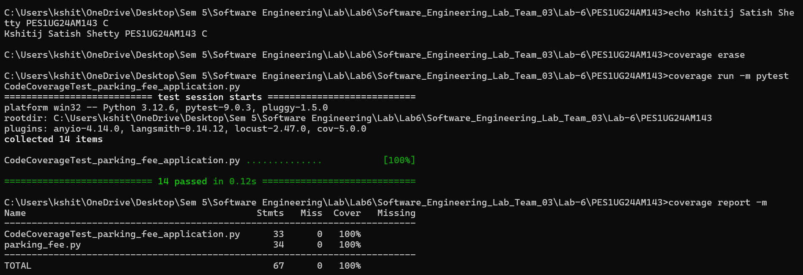
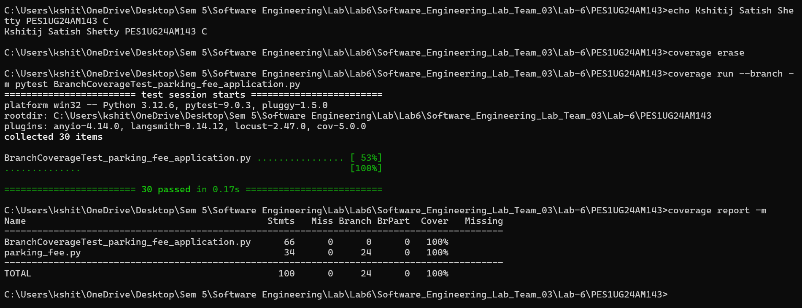

# Lab 6 – Code and Branch Coverage Analysis

**Student:** Kshitij Satish Shetty  
**SRN:** PES1UG24AM143  
**Section:** C  
**Project:** Parking Fee  
**Lab:** Lab 6 – Code and Branch Coverage

## 1. Overview

This lab focuses on measuring and improving code coverage and branch coverage using Python's `coverage` library and `pytest`.

The project tests a parking fee application that handles:
- Fee calculation by vehicle type and parking duration
- Free grace period and hourly rounding
- Electric vehicle discount
- Lost ticket penalty
- Parking slot assignment
- Monthly pass pricing

The objective is to achieve at least 90% code coverage and branch coverage by writing comprehensive test cases.

## 2. Application Details

The application is implemented in `parking_fee.py`.

It consists of three main functions:

| Function | Description |
|---|---|
| `parking_fee()` | Validates the vehicle and duration, calculates the fee, applies the EV discount and adds the lost ticket penalty. |
| `find_slot()` | Returns the slot type based on free slots, disability status and vehicle type. |
| `monthly_pass()` | Returns the monthly pass price for a bike or car, with a resident discount. |

### Hourly Rates

| Vehicle | Rate per hour |
|---|---:|
| Bike | 10 |
| Car | 30 |
| Truck | 60 |

### Business Rules

- Stays of 30 minutes or less are free.
- Longer stays are charged per hour, and a partial hour is rounded up.
- EV bikes and cars get a 50% discount (trucks do not).
- A lost ticket adds a flat penalty of 200.
- Monthly pass: bike 500, car 1500, with a 20% resident discount. Trucks have no pass.

## 3. Project Structure

```text
PES1UG24AM143/
│
├── parking_fee.py
├── test_parking_fee.py
├── CodeCoverageTest_parking_fee_application.py
├── BranchCoverageTest_parking_fee_application.py
├── README.md
│
└── screenshots/
    ├── code_coverage.png
    └── branch_coverage.png
```

## 4. Test Cases

### 4.1 Code Coverage Tests

File: `CodeCoverageTest_parking_fee_application.py`

The test cases cover:

- Free short stay
- Unknown vehicle
- Negative duration
- Exact hours (no rounding)
- Partial hour rounded up
- EV discount
- Lost ticket penalty
- Slot assignment: any floor, full, disabled, truck basement
- Monthly pass for bike, resident car and invalid vehicle

### 4.2 Branch Coverage Tests

File: `BranchCoverageTest_parking_fee_application.py`

The test cases exercise both True and False outcomes of every decision branch, including:

- Vehicle validation (known and unknown)
- Duration validation (negative and valid)
- Free-stay boundary at 30 and 31 minutes, and zero minutes
- Rounding condition (exact hour and partial hour)
- EV discount for car, bike and truck, and non-EV
- Lost ticket with paid and free stays, and combined with EV
- Slot conditions: zero and negative free slots, one slot left, disabled, truck, bike
- Monthly pass for bike and car, resident and non-resident, and invalid vehicles

**Note:** The original `parking_fee.py` application is retained unchanged. Coverage is improved through additional test cases.

## 5. Requirements

- Python 3.x
- pytest
- coverage

Install the required dependencies:

```bash
pip install pytest coverage
```

## 6. Code Coverage Analysis

Run the following commands:

```bash
coverage erase

coverage run -m pytest CodeCoverageTest_parking_fee_application.py

coverage report -m
```

### Result

- Test cases executed: 14
- Test cases passed: 14
- Statement coverage: 100%

### Code Coverage Screenshot



## 7. Branch Coverage Analysis

Run the following commands:

```bash
coverage erase

coverage run --branch -m pytest BranchCoverageTest_parking_fee_application.py

coverage report -m
```

### Result

- Test cases executed: 30
- Test cases passed: 30
- Branches: 24
- Partial branches: 0
- Branch coverage: 100%

### Branch Coverage Screenshot



## 8. Coverage Summary

| Coverage Type | Achieved Coverage | Required Coverage |
|---|---:|---:|
| Code Coverage | 100% | 90% |
| Branch Coverage | 100% | 90% |

Both coverage requirements have been achieved based on the recorded test executions.

## 9. Deliverables

The following deliverables are included:

1. `CodeCoverageTest_parking_fee_application.py` – Code coverage test cases.
2. `BranchCoverageTest_parking_fee_application.py` – Branch coverage test cases.
3. `screenshots/code_coverage.png` – Code coverage terminal output.
4. `screenshots/branch_coverage.png` – Branch coverage terminal output.
5. `parking_fee.py` – Original application.
6. `test_parking_fee.py` – Starter test file.
7. `README.md` – Project documentation and coverage analysis.

## 10. GitHub Commits

The Lab 6 submission was pushed to the team repository using separate commits:

1. `Lab 6: code coverage tests and report (PES1UG24AM143)`
2. `Lab 6: branch coverage tests and report (PES1UG24AM143)`
3. `Lab 6: organise folder, add screenshots folder and README (PES1UG24AM143)`

Repository:

[Software Engineering Lab Team 03](https://github.com/mallikarjunrao-sketch/Software_Engineering_Lab_Team_03)

---

**Lab 6 Submission – PES1UG24AM143**
