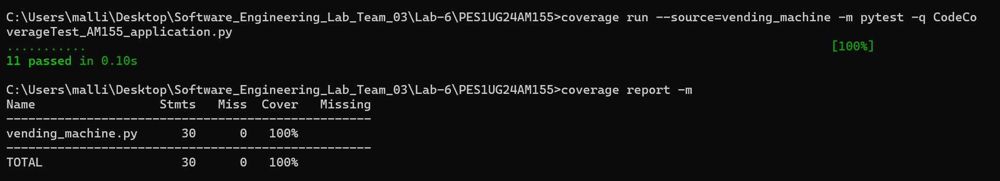
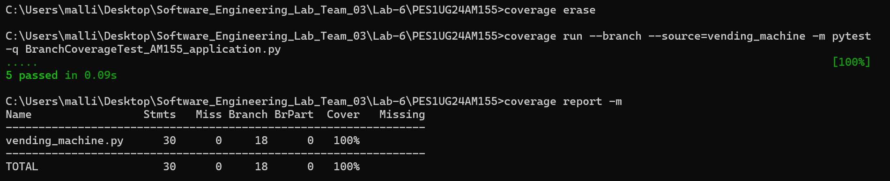

# Lab 6 – Code and Branch Coverage Analysis

**Student:** Mallikarjuna Rao R.V.  
**SRN:** PES1UG24AM155  
**Project:** Vending Machine  
**Lab:** Lab 6 – Code and Branch Coverage

## 1. Overview

This lab focuses on measuring and improving code coverage and branch coverage using Python's `coverage` library and `pytest`.

The project tests a vending machine application that handles:
- Item selection
- Stock availability
- Credit validation
- Change-making
- Purchase processing

The objective is to achieve at least 90% code coverage and branch coverage by writing comprehensive test cases.

## 2. Application Details

The application is implemented in `vending_machine.py`.

It consists of three main functions:

| Function | Description |
|---|---|
| `select_item()` | Validates the selected item, stock availability and available credit. |
| `make_change()` | Calculates change using available coin denominations. |
| `purchase()` | Processes purchases, returns change and updates stock. |

### Item Prices

| Item | Price |
|---|---:|
| Cola | 150 |
| Chips | 100 |
| Candy | 75 |

### Available Coins

`[100, 50, 25, 10, 5]`

## 3. Project Structure

```text
PES1UG24AM155/
│
├── vending_machine.py
├── test_vending_machine.py
├── CodeCoverageTest_AM155_application.py
├── BranchCoverageTest_AM155_application.py
├── README.md
│
└── screenshots/
    ├── code_coverage.png
    └── branch_coverage.png
```

## 4. Test Cases

### 4.1 Code Coverage Tests

File: `CodeCoverageTest_AM155_application.py`

The test cases cover:

- Invalid item selection
- Sold-out items
- Insufficient credit
- Valid item selection
- Zero change
- Multiple coin denominations
- Unrepresentable change amounts
- Negative change amounts
- Rejected purchases
- Successful purchases
- Stock decrement after purchase
- Purchases with no exact change

### 4.2 Branch Coverage Tests

File: `BranchCoverageTest_AM155_application.py`

The test cases exercise both True and False outcomes of decision branches, including:

- Item validation conditions
- Stock availability conditions
- Credit validation conditions
- Negative amount validation
- Coin-making loop conditions
- Exact change availability
- Purchase success and failure conditions

**Note:** The original `vending_machine.py` application is retained unchanged. Coverage is improved through additional test cases.

## 5. Requirements

- Python 3.x
- pytest
- coverage

Install the required dependencies:

```bash
py -m pip install pytest coverage
```

## 6. Code Coverage Analysis

Run the following commands:

```bash
coverage erase

coverage run --source=vending_machine -m pytest -q CodeCoverageTest_AM155_application.py

coverage report -m --include=vending_machine.py
```

### Result

- Test cases executed: 11
- Test cases passed: 11
- Statement coverage: 100%

### Code Coverage Screenshot



## 7. Branch Coverage Analysis

Run the following commands:

```bash
coverage erase

coverage run --branch --source=vending_machine -m pytest -q BranchCoverageTest_AM155_application.py

coverage report -m --include=vending_machine.py
```

### Result

- Test cases executed: 5
- Test cases passed: 5
- Branches: 18
- Partial branches: 0
- Branch coverage: 100%

### Branch Coverage Screenshot



## 8. Coverage Summary

| Coverage Type | Achieved Coverage | Required Coverage |
|---|---:|---:|
| Code Coverage | 100% | 90% |
| Branch Coverage | 100% | 90% |

Both coverage requirements have been achieved based on the recorded test executions.

## 9. Deliverables

The following deliverables are included:

1. `CodeCoverageTest_AM155_application.py` – Code coverage test cases.
2. `BranchCoverageTest_AM155_application.py` – Branch coverage test cases.
3. `screenshots/code_coverage.png` – Code coverage terminal output.
4. `screenshots/branch_coverage.png` – Branch coverage terminal output.
5. `vending_machine.py` – Original application.
6. `test_vending_machine.py` – Starter test file.
7. `README.md` – Project documentation and coverage analysis.

## 10. GitHub Commits

The Lab 6 submission was pushed to the team repository using separate commits:

1. `Add AM155 Lab 6 code coverage tests`
2. `Add AM155 Lab 6 branch coverage tests`
3. `Add AM155 Lab 6 vending machine application`

Repository:

[Software Engineering Lab Team 03](https://github.com/mallikarjunrao-sketch/Software_Engineering_Lab_Team_03)

---

**Lab 6 Submission – PES1UG24AM155**
