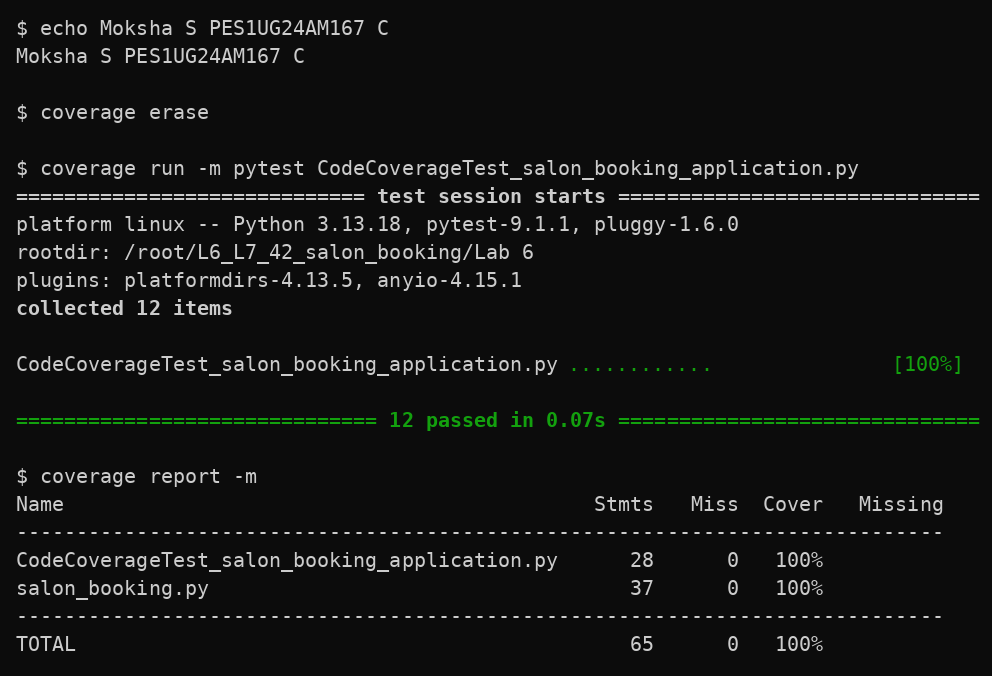
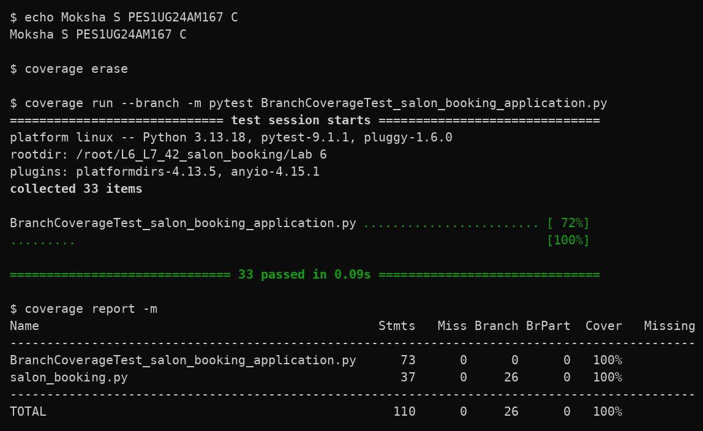

# Lab 6: Code and Branch Coverage Analysis

**Student:** Moksha S
**SRN:** PES1UG24AM167
**Section:** C
**Project:** Salon Booking (`L6_L7_42_salon_booking`)
**Lab:** Lab 6, Code and Branch Coverage

## 1. Overview

This lab measures and improves code (statement) coverage and branch coverage using Python's `coverage` library with `pytest`.

The application under test is a salon booking module that:

- works out extra-time charges by service, stylist level and membership
- checks whether a booking can be made, based on party size, number of services and walk-in status
- reports a client's arrival status as `"open"`, `"late"` or `"closed"`

The goal is at least 90% code coverage and at least 90% branch coverage.

## 2. Application details

The application is `salon_booking.py`. It has three functions:

| Function | Description |
|---|---|
| `extra_time_charge()` | Validates the service and duration, works out the included minutes (with the member bonus) and charges for any extra minutes based on stylist level. |
| `can_book()` | Decides whether a booking is allowed, based on walk-in status, party size and number of services. |
| `arrival_status()` | Returns `"open"`, `"late"` or `"closed"` depending on how early the client arrives, whether it is a colour service and whether it is a weekend. |

### Included minutes (`INCLUDED_MIN`)

| Service | Included minutes |
|---|---:|
| haircut | 30 |
| colour | 60 |
| spa | 90 |

### Business rules

- An unknown service or a negative duration raises `ValueError`.
- Members get 15 extra included minutes on haircut and colour, but not on spa.
- If the duration is within the included minutes, the charge is `0`.
- Extra minutes cost `10` per minute with a junior stylist and `18` per minute otherwise.
- If the extra time is more than 60 minutes, the rate goes up by `8`, and by a further `4` for a senior stylist.
- Walk-ins can book for a party of at most 2. Other bookings allow a party of at most 4 and at most 2 services.
- The arrival cutoff is `10` minutes for colour and `5` otherwise, plus `10` on weekends. Arriving at least `cutoff` minutes early is `"open"`, up to 15 minutes short of that is `"late"`, and anything less is `"closed"`.

## 3. Project structure

```text
Lab 6/
├── salon_booking.py
├── test_salon_booking.py
├── CodeCoverageTest_salon_booking_application.py
├── BranchCoverageTest_salon_booking_application.py
├── README.md
└── screenshots/
    ├── code_coverage.png
    └── branch_coverage.png
```

## 4. Test cases

### 4.1 Code coverage tests

File: `CodeCoverageTest_salon_booking_application.py` (12 tests)

These run every line of `salon_booking.py` at least once:

- within included time (charge `0`)
- unknown service and negative duration (`ValueError`)
- member bonus minutes
- junior stylist charge with extra time of 60 minutes or less
- senior stylist charge with extra time over 60 minutes
- normal booking, walk-in booking and a party that is too large
- arrival statuses `"open"` (colour, weekend), `"late"` and `"closed"`

### 4.2 Branch coverage tests

File: `BranchCoverageTest_salon_booking_application.py` (33 tests)

These make every decision in the code go both ways (all 26 branches), including:

- service check: all three valid services and an unknown one
- duration check: negative duration and zero duration
- member bonus condition `is_member and service != "spa"`: member on haircut and colour, member on spa, and non-member
- extra time boundary: negative extra, exactly `0` extra and `1` extra minute
- stylist rate: junior and non-junior
- overrun boundary: exactly `60` extra minutes and `61` extra minutes
- nested senior surcharge inside the overrun: senior and a non-junior, non-senior (`"mid"`) stylist
- walk-in at the limit (2) and over it (3)
- party size boundary (4 and 5) and services boundary (2 and 3)
- arrival status for all four combinations of colour/regular and weekday/weekend, each tested at the exact `"open"`, `"late"` and `"closed"` boundaries

The original `salon_booking.py` is unchanged. Coverage was improved only by adding tests.

## 5. Requirements

- Python 3.x
- pytest
- coverage

```bash
pip install pytest coverage
```

## 6. Code coverage analysis

```bash
coverage erase
coverage run -m pytest CodeCoverageTest_salon_booking_application.py
coverage report -m
```

### Result

- Tests run: 12
- Tests passed: 12
- Statement coverage of `salon_booking.py`: 100%

For comparison, the starter `test_salon_booking.py` (2 tests) covered only 32% of `salon_booking.py`.

### Code coverage screenshot



## 7. Branch coverage analysis

```bash
coverage erase
coverage run --branch -m pytest BranchCoverageTest_salon_booking_application.py
coverage report -m
```

### Result

- Tests run: 33
- Tests passed: 33
- Branches: 26
- Partial branches: 0
- Branch coverage of `salon_booking.py`: 100%

### Branch coverage screenshot



## 8. Line coverage vs branch coverage

The code coverage test file reaches 100% line coverage, but run with `--branch` it gives 98% and reports one missing branch, `21->23`. Every line runs, yet the case where the extra time is over 60 minutes and the stylist is not senior is never tested. The branch coverage file adds `test_mid_level_long_overrun` for this, which brings branch coverage to 100%. This shows why full line coverage does not guarantee every decision has been tested.

## 9. Coverage summary

| Coverage type | Achieved | Required |
|---|---:|---:|
| Code coverage | 100% | 90% |
| Branch coverage | 100% | 90% |

## 10. Deliverables

1. `CodeCoverageTest_salon_booking_application.py`: code coverage tests
2. `BranchCoverageTest_salon_booking_application.py`: branch coverage tests
3. `screenshots/code_coverage.png`: code coverage terminal output
4. `screenshots/branch_coverage.png`: branch coverage terminal output
5. `salon_booking.py`: original application
6. `test_salon_booking.py`: starter test file
7. `README.md`: this file

## 11. Commits

1. `Lab 6: code coverage tests and report (PES1UG24AM167)`
2. `Lab 6: branch coverage tests and report (PES1UG24AM167)`
3. `Lab 6: add README documentation (PES1UG24AM167)`
