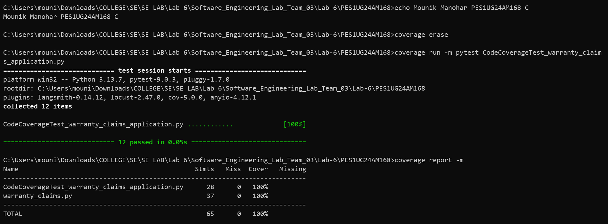
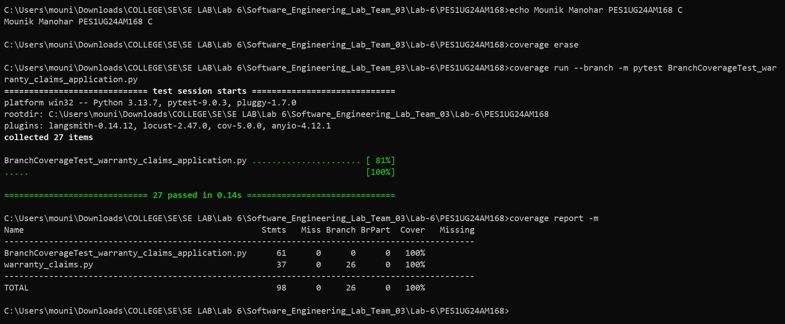

# Lab 6 – Code and Branch Coverage Analysis

**Student:** Mounik Manohar  
**SRN:** PES1UG24AM168  
**Section:** C  
**Project:** Warranty Claims (`L6_L7_43_warranty_claims`)  
**Lab:** Lab 6 – Code and Branch Coverage

## 1. Overview

This lab focuses on measuring and improving code coverage and branch coverage using Python's `coverage` library and `pytest`.

The project tests a warranty claims application that handles:
- Out-of-warranty repair charge calculation by plan, product age, claim type, and registration status
- Registration bonus warranty extension for non-premium plans
- Excess age surcharge calculation for defect and accidental claims
- Warranty claim eligibility checks based on recall status, days since last claim, and prior claims filed
- Service Level Agreement (SLA) status reporting based on remaining hours, hardware classification, and priority level

The objective is to achieve at least 90% code coverage and branch coverage by writing comprehensive test cases.

## 2. Application Details

The application is implemented in `warranty_claims.py`.

It consists of three main functions:

| Function | Description |
|---|---|
| `out_of_warranty_charge()` | Validates the plan and product age, calculates covered warranty months (including registration bonus), and computes out-of-warranty charges based on excess months and claim type. |
| `claim_allowed()` | Determines whether a new warranty claim is permitted based on recall status, days elapsed since the last claim, and total claims filed. |
| `sla_status()` | Evaluates whether a claim's resolution timeline is `"on_track"`, `"at_risk"`, or `"critical"` based on remaining hours, hardware status, and priority flag. |

### Warranty Plans (`COVERED_MONTHS`)

| Plan | Base Covered Months |
|---|---:|
| Basic | 12 |
| Standard | 24 |
| Premium | 36 |

### Business Rules

- Registered products on `"basic"` or `"standard"` plans receive an extra 6 months of warranty coverage (`"premium"` plans do not).
- Products within their covered warranty period (`excess <= 0`) incur a charge of `0`.
- Out-of-warranty base rates per excess month: `200` for `"accidental"` claims, `100` for other claims (e.g., `"defect"`).
- If `excess > 12` months, the rate increases by `50` (plus an additional `25` if `claim_type == "accidental"`).
- Recall claims are allowed for up to 5 prior claims regardless of days since last claim; non-recall claims require at least 30 days since the last claim and at most 2 prior claims.
- Base SLA cutoff is `48` hours for hardware and `24` hours for non-hardware, increased by `24` hours for priority claims. Claims with `hours_left >= cutoff` are `"on_track"`, `hours_left >= cutoff - 12` are `"at_risk"`, and below `cutoff - 12` are `"critical"`.

## 3. Project Structure

```text
PES1UG24AM168/
│
├── warranty_claims.py
├── test_warranty_claims.py
├── CodeCoverageTest_warranty_claims_application.py
├── BranchCoverageTest_warranty_claims_application.py
├── README.md
│
└── screenshots/
    ├── code_coverage.png
    └── branch_coverage.png
```

## 4. Test Cases

### 4.1 Code Coverage Tests

File: `CodeCoverageTest_warranty_claims_application.py`

The test cases cover:

- Within-warranty standard defect claim
- Unknown warranty plan (`ValueError`)
- Negative product age (`ValueError`)
- Registered product bonus coverage extension
- Out-of-warranty defect charge (`excess <= 12`)
- Out-of-warranty accidental charge with high excess surcharge (`excess > 12`)
- Recall claim eligibility
- Non-recall claim rejected due to recent claim (`< 30` days)
- Standard non-recall claim allowed
- SLA statuses: `"on_track"` (hardware + priority), `"at_risk"`, and `"critical"`

### 4.2 Branch Coverage Tests

File: `BranchCoverageTest_warranty_claims_application.py`

The test cases exercise both True and False outcomes of every decision branch (all 26 branches), including:

- Plan validation (valid `"basic"`, `"standard"`, `"premium"` plans vs. unknown plan)
- Product age validation (negative age vs. zero/positive age)
- Registration bonus condition (`is_registered and plan != "premium"`: registered non-premium, registered premium, and unregistered)
- Excess months boundary (`excess < 0`, `excess == 0`, and `excess == 1`)
- Claim type rate selection (`"accidental"` vs. `"defect"`)
- High-excess surcharge condition (`excess <= 12` boundary at 12 vs. `excess > 12` boundary at 13)
- Nested accidental surcharge inside `excess > 12` (both `"accidental"` and `"defect"` when `excess > 12`)
- Recall vs. non-recall claims (within and exceeding claim limits)
- Days since last claim boundary (`29` days vs. `30` days) and non-recall claim count boundary (`2` vs. `3`)
- SLA hardware vs. software, priority vs. non-priority, and exact cutoff boundaries for `"on_track"`, `"at_risk"`, and `"critical"`

**Note:** The original `warranty_claims.py` application is retained unchanged. Coverage is improved through additional test cases.

## 5. Requirements

- Python 3.x
- pytest
- coverage

Install the required dependencies:

```bash
pip install pytest coverage
```

## 6. Code Coverage Analysis

Run the following commands:

```bash
coverage erase

coverage run -m pytest CodeCoverageTest_warranty_claims_application.py

coverage report -m
```

### Result

- Test cases executed: 12
- Test cases passed: 12
- Statement coverage: 100%

### Code Coverage Screenshot



## 7. Branch Coverage Analysis

Run the following commands:

```bash
coverage erase

coverage run --branch -m pytest BranchCoverageTest_warranty_claims_application.py

coverage report -m
```

### Result

- Test cases executed: 27
- Test cases passed: 27
- Branches: 26
- Partial branches: 0
- Branch coverage: 100%

### Branch Coverage Screenshot



## 8. Coverage Summary

| Coverage Type | Achieved Coverage | Required Coverage |
|---|---:|---:|
| Code Coverage | 100% | 90% |
| Branch Coverage | 100% | 90% |

Both coverage requirements have been achieved based on the recorded test executions.

## 9. Deliverables

The following deliverables are included:

1. `CodeCoverageTest_warranty_claims_application.py` – Code coverage test cases.
2. `BranchCoverageTest_warranty_claims_application.py` – Branch coverage test cases.
3. `screenshots/code_coverage.png` – Code coverage terminal output.
4. `screenshots/branch_coverage.png` – Branch coverage terminal output.
5. `warranty_claims.py` – Original application.
6. `test_warranty_claims.py` – Starter test file.
7. `README.md` – Project documentation and coverage analysis.

## 10. GitHub Commits

The Lab 6 submission was pushed to the team repository using separate commits:

1. `Lab 6: code coverage tests and report (PES1UG24AM168)`
2. `Lab 6: branch coverage tests and report (PES1UG24AM168)`
3. `Lab 6: add README documentation (PES1UG24AM168)`

Repository:

[Software Engineering Lab Team 03](https://github.com/mallikarjunrao-sketch/Software_Engineering_Lab_Team_03)

---

**Lab 6 Submission – PES1UG24AM168**
