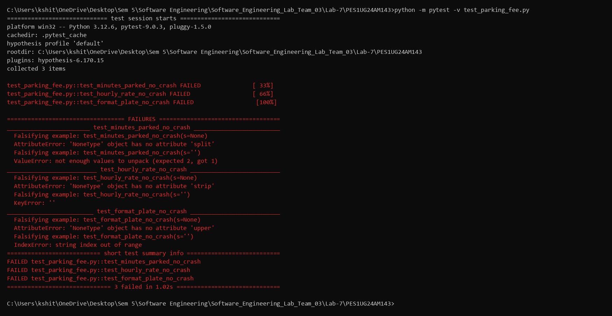
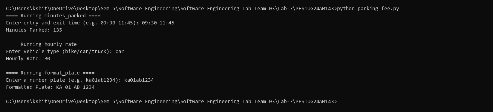
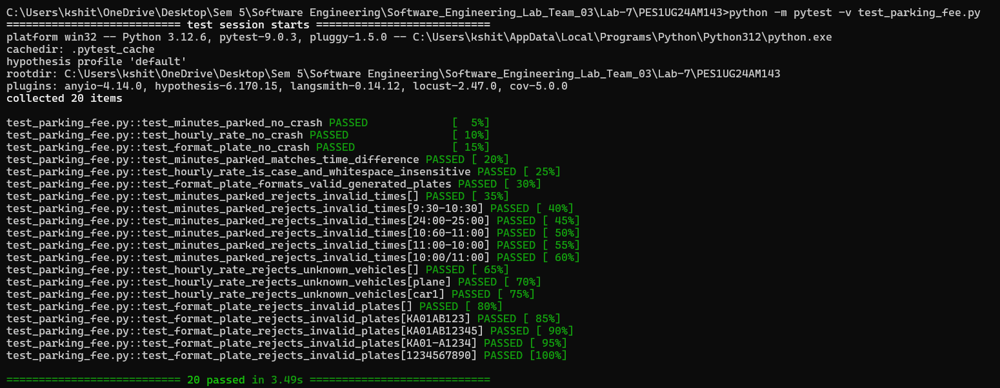

# Lab 7 – Fuzz Testing: Parking Fee

**Student:** Kshitij Satish Shetty  
**SRN:** PES1UG24AM143  
**Section:** C  
**Project:** Parking Fee (`L6_L7_19_parking_fee`)  
**Lab:** Lab 7 – Fuzz Testing

## 1. Files

- `parking_fee.py`: robust implementation of the three parking-fee functions (`minutes_parked`, `hourly_rate`, `format_plate`).
- `test_parking_fee.py`: Hypothesis property-based / fuzz tests covering 20 test cases.
- `PES1UG24AM143_Lab7_Report.pdf`: Completed lab report with screenshots and observations.
- `screenshots/failing_tests.png`: Terminal output showing initial test failures under Hypothesis on the buggy code.
- `screenshots/parking_fee_execution.png`: Interactive terminal execution of `python parking_fee.py`.
- `screenshots/pytest_results.png` (`screenshots/fuzz_testing.png`): Terminal output of `python -m pytest -v test_parking_fee.py` showing all 20 tests passing.

## 2. Setup

Open a terminal in this folder and install the dependencies:

```powershell
python -m pip install hypothesis pytest
```

### Run the fuzz tests

```powershell
python -m pytest -v
```

### Run the interactive program

```powershell
python parking_fee.py
```

## 3. Expected Behavior

- `minutes_parked("09:30-11:45")` returns `135`; invalid format or exit earlier than entry raises `ValueError`.
- `hourly_rate("car")` returns `30` (supports `"bike"`, `"car"`, `"truck"`, case- and whitespace-insensitive); invalid/unknown vehicle raises `ValueError`.
- `format_plate("ka01ab1234")` returns `"KA 01 AB 1234"` (expects Indian format `LLDDLLDDDD`); invalid format raises `ValueError`.

## 4. Lab Deliverables

1. Completed `parking_fee.py` (defensive hardening against edge cases).
2. Completed `test_parking_fee.py` with Hypothesis property-based fuzz tests.
3. Test execution evidence:
   - Initial failing tests screenshot: `screenshots/failing_tests.png`
   - Fixed interactive execution screenshot: `screenshots/parking_fee_execution.png`
   - Final passing tests screenshot: `screenshots/pytest_results.png` / `screenshots/fuzz_testing.png`
4. Observations and bug analysis table detailing crashes found in the original starter code.
5. Final PDF Report document: `PES1UG24AM143_Lab7_Report.pdf`.
6. Conclusion explaining fuzz testing with Hypothesis.

## 5. Observations

The original parking fee program was tested using the Hypothesis library (`@given(st.text() | st.none())`) to identify unhandled exceptions and edge-case bugs caused by unexpected inputs.

The following bugs were identified in the original starter implementation:

| Function | Bug Identified | Solution Implemented |
|---|---|---|
| `minutes_parked()` | 1. Passing `None` raises `AttributeError` on `.split('-')`.<br>2. Strings without exactly one `-` (e.g. `""`, `"09:30"`, `"a-b-c"`) raise `ValueError` on unpacking.<br>3. Missing colons or non-integer tokens (e.g. `"a:b-c:d"`) raise `ValueError`.<br>4. Exit time earlier than entry time (e.g. `"12:00-11:00"`) returns a negative duration without error. | Added `isinstance(times, str)` check, strict regular expression matching for `HH:MM-HH:MM` in 24-hour time range `[00:00 - 23:59]`, verified `end >= start`, and raised `ValueError` on any invalid input. |
| `hourly_rate()` | 1. Passing `None` raises `AttributeError` on `.strip()`.<br>2. Passing unknown vehicle types (e.g. `""`, `"plane"`, `"car1"`) raises an unhandled `KeyError`. | Added `isinstance(vehicle, str)` validation, stripped whitespace, converted to lowercase, verified membership in the `RATES` dictionary, and raised `ValueError("unknown vehicle")` for invalid inputs. |
| `format_plate()` | 1. Passing `None` raises `AttributeError` on `.upper()`.<br>2. Strings shorter than 2 characters (e.g. `""`, `"k"`) raise `IndexError: string index out of range` on `p[0]` and `p[1]`.<br>3. Non-standard plate formats (e.g. `"1234567890"`, `"KA01AB123"`) bypass formatting without validation. | Added string type check, stripped and uppercased input, added strict regex validation for Indian vehicle registration plates (`^[A-Z]{2}[0-9]{2}[A-Z]{2}[0-9]{4}$`), and raised `ValueError` on invalid plate numbers. |

### Additional Observations

- Hypothesis automatically generated counterexamples including `None`, empty strings `""`, malformed strings (`"-"`), and boundary inputs.
- Both fuzz tests for arbitrary inputs (`*_no_crash`) and property tests for generated valid inputs (`*_matches_time_difference`, `*_formats_valid_generated_plates`) were implemented.
- Input validation eliminated all unhandled crashes.
- All 20 automated tests passed successfully.

## 6. Execution Screenshots

### Initial Test Failures (Buggy Starter Code)



### Interactive Program Execution (Fixed Code)



### Final Pytest & Hypothesis Fuzz Testing Results



## 7. Conclusion

In this lab, property-based fuzz testing was implemented using Python's `hypothesis` library and `pytest` framework on the `parking_fee.py` application.

Hypothesis automatically generates hundreds of edge cases—including `None`, empty strings, missing delimiters, boundary values, and malformed formats—exposing unhandled `AttributeError`, `KeyError`, and `IndexError` crashes that typical unit testing fails to reveal.

After adding strict regex validation, type checking, boundary bounds, and exception handling, the module passed all 20 property-based and boundary test cases cleanly.

---

**Lab 7 Submission – PES1UG24AM143**
