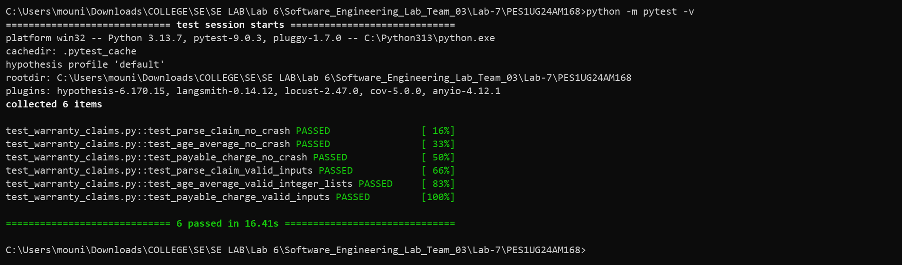
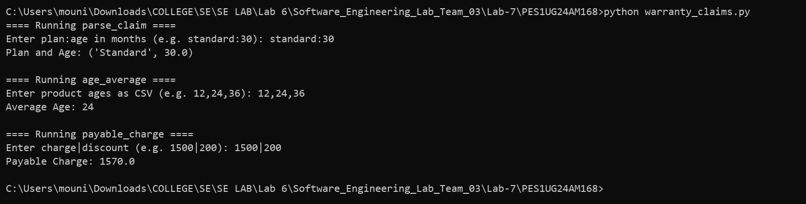

# Lab 7 – Fuzz Testing: Warranty Claims

**Student:** Mounik Manohar  
**SRN:** PES1UG24AM168  
**Section:** C  
**Project:** Warranty Claims (`L6_L7_43_warranty_claims`)  
**Lab:** Lab 7 – Fuzz Testing

## 1. Files

- `warranty_claims.py`: robust implementation of the three warranty-claims functions (`parse_claim`, `age_average`, `payable_charge`).
- `test_warranty_claims.py`: Hypothesis property-based / fuzz tests.
- `screenshots/pytest_results.png` (`screenshots/fuzz_testing.png`): terminal output of `python -m pytest -v`.
- `screenshots/warranty_claims_execution.png`: interactive terminal execution of `python warranty_claims.py`.

## 2. Setup

Open a terminal in this folder and install the dependencies:

```powershell
python -m pip install hypothesis pytest
```

### Run the fuzz tests

```powershell
python -m pytest -v
```

### Run the interactive program

```powershell
python warranty_claims.py
```

## 3. Expected Behavior

- `parse_claim("standard:30")` returns `('Standard', 30.0)`; invalid input (`None`, missing/multiple colons, empty plan name, non-numeric or negative/non-finite age) returns `None`.
- `age_average("12,24,36")` returns `24`; invalid input (`None`, empty string, non-integer elements, or negative ages) returns `None`.
- `payable_charge("1500|200")` returns `1570.0` (`max(1500 * 1.18 - 200, 0.0)`); invalid input (`None`, missing/multiple `|`, non-numeric values, `NaN`/`inf`, or negative charge/discount) returns `None`.

## 4. Lab Deliverables

1. Completed `warranty_claims.py`.
2. Completed `test_warranty_claims.py` with Hypothesis tests.
3. Test execution evidence: screenshot of `python -m pytest -v` showing all tests passing (`screenshots/pytest_results.png` and `screenshots/warranty_claims_execution.png`).
4. Short observation/report listing bugs found in the original starter code and how they were handled.
5. Conclusion explaining that Hypothesis generates many inputs automatically and helps expose unexpected-input failures.

## 5. Observations

The original warranty claims program was tested using the Hypothesis library (`@given(st.text() | st.none())`) to identify unhandled exceptions and edge-case bugs caused by unexpected inputs.

The following bugs were identified in the original starter implementation:

| Function | Bug Identified | Solution Implemented |
|---|---|---|
| `parse_claim()` | 1. Passing `None` raises `AttributeError` on `.split(':')`.<br>2. Strings without exactly one `:` (e.g., `""`, `"standard"`, `"a:b:c"`) raise `ValueError` during unpacking.<br>3. Non-numeric month strings (e.g., `"standard:abc"`) raise `ValueError` in `float(months)`.<br>4. Empty plan names (`":30"`), negative ages (`"standard:-5"`), or special floats (`"standard:nan"`, `"standard:inf"`) are accepted without validation. | Added `isinstance(text, str)` validation, verified `len(parts) == 2`, required a non-empty alphabetic plan name, wrapped `float()` conversion in `try...except ValueError`, and verified `math.isfinite(months)` and `months >= 0`. Returns `None` on invalid input. |
| `age_average()` | 1. Passing `None` raises `AttributeError` on `.split(',')`.<br>2. Empty strings (`""`), trailing commas (`"12,"`), or non-integer tokens (`"12,abc,36"`) raise `ValueError` in `int(r)`.<br>3. Negative product ages (e.g., `"-10,20"`) are accepted without validation. | Added type and non-empty string checks, rejected empty CSV tokens, wrapped `[int(part) for part in parts]` in `try...except ValueError`, and rejected negative values (`value < 0`). Returns `None` on invalid input. |
| `payable_charge()` | 1. Passing `None` raises `AttributeError` on `.split('|')`.<br>2. Strings without `|` or with multiple `|` (e.g., `""`, `"1500"`, `"100|20|5"`) raise `ValueError` during unpacking.<br>3. Non-numeric charge/discount values (e.g., `"abc|200"`) raise `ValueError` in `float()`.<br>4. Special float strings (`"nan|0"`, `"inf|100"`, `"1e308|0"`) propagate `NaN` or `inf`, and negative charges/discounts are not rejected. | Added `isinstance(text, str)` check, verified `len(parts) == 2`, wrapped `float()` parsing in `try...except ValueError`, enforced `math.isfinite()` and non-negativity (`charge >= 0`, `discount >= 0`), and verified `math.isfinite(total)`. Returns `None` on invalid input. |

### Additional Observations

- Hypothesis automatically generated diverse counterexamples, including `None`, empty strings `""`, delimiter-only strings (`":"`, `"|"`), special floating-point literals (`"nan"`, `"inf"`), and negative numbers.
- Both arbitrary fuzzed inputs (`*_no_crash`) and valid generated property inputs (`*_valid_inputs`) were tested.
- Input validation and exception handling eliminated all unhandled runtime crashes.
- All 6 automated Hypothesis test suites passed completely.

## 6. Execution Screenshots

### Pytest & Hypothesis Fuzz Testing Output



### Interactive Program Execution



## 7. Conclusion

In this lab, property-based fuzz testing was implemented using the Python `hypothesis` library and `pytest` framework on the `warranty_claims.py` module.

Hypothesis automatically generates hundreds of structured and unstructured test inputs—including `None`, empty strings, malformed delimiters, boundary integers, and special floating-point values (`NaN`, `inf`)—exposing unhandled `AttributeError` and `ValueError` crashes that ordinary manual unit tests often miss.

After adding strict input validation, finiteness checks, and exception handling to `parse_claim()`, `age_average()`, and `payable_charge()`, the module passed all 6 property-based test suites without any crashes.

---

**Lab 7 Submission – PES1UG24AM168**
